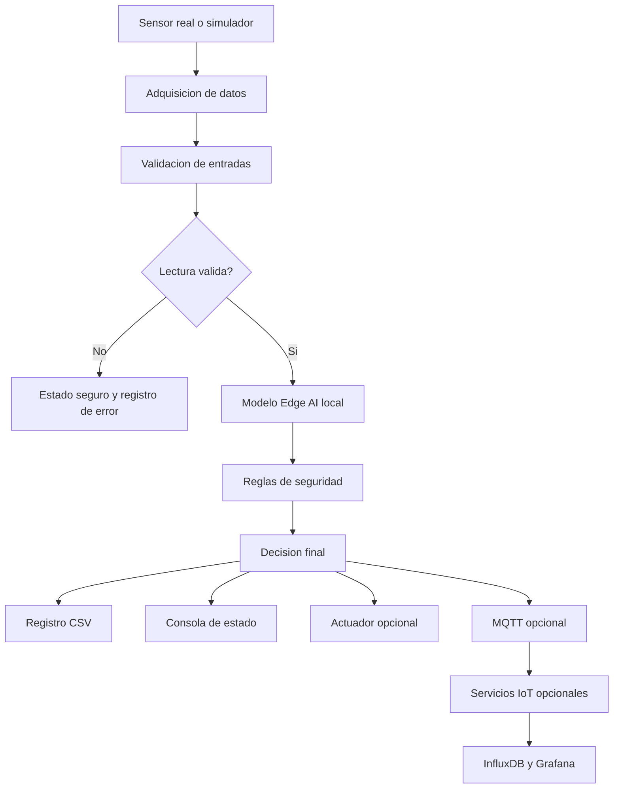

# Capítulo 18. Diseño del proyecto final

!!! info "Parte VI — Proyecto final integrador"
    En este capítulo diseñaremos un sistema completo de monitorización ambiental con inteligencia artificial local sobre Arduino UNO Q. El capítulo 19 se dedicará a implementarlo y probarlo; el capítulo 20, a documentarlo y presentarlo.

## 18.1. Introducción y objetivos

A lo largo del libro hemos trabajado con Linux, Python, redes, servicios web, MQTT, InfluxDB, Grafana y modelos de inteligencia artificial. El proyecto final debe integrar estos conocimientos en una solución coherente, verificable y segura.

El proyecto propuesto se denomina **Sistema de monitorización ambiental y control inteligente con Edge AI**. La placa Arduino UNO Q recibirá lecturas de temperatura, humedad y luminosidad, ejecutará un modelo local que recomendará una acción, registrará los resultados y, cuando esté disponible, los comunicará a otros servicios.

**Objetivos de aprendizaje:**

- Analizar una necesidad y traducirla en requisitos verificables.
- Diseñar una arquitectura que distinga adquisición, inferencia, decisión, comunicación y visualización.
- Definir un formato de datos común y las interfaces entre componentes.
- Diseñar medidas de seguridad antes de conectar actuadores reales.
- Preparar una planificación de implementación y un plan de pruebas.
- Elaborar documentación técnica reutilizable en el capítulo 19.

**Resultados esperados:** al finalizar el capítulo, cada grupo dispondrá de una especificación del proyecto, un diagrama de arquitectura, una estructura de carpetas, un contrato de datos, una matriz de pruebas, un análisis de riesgos y un cronograma.

## 18.2. Planteamiento del problema

Imaginemos un aula o pequeño laboratorio en el que queremos supervisar las condiciones ambientales. La información de los sensores puede servir para conocer el estado del entorno y para recomendar actuaciones, por ejemplo encender un ventilador cuando la temperatura sea elevada.

Un sistema convencional utiliza reglas fijas. Un sistema Edge AI incorpora además un modelo entrenado que clasifica las condiciones observadas. **La predicción del modelo no debe conectarse directamente a un actuador**: debe pasar por una capa de validación y seguridad.

### 18.2.1. Alcance obligatorio

La versión mínima del proyecto deberá:

1. Obtener lecturas de temperatura, humedad y luminosidad, reales o simuladas.
2. Validar los valores recibidos y rechazar entradas incorrectas.
3. Ejecutar localmente un modelo de clasificación o un mecanismo equivalente desarrollado en los capítulos 15 y 17.
4. Proponer una acción de control: `NORMAL`, `VENTILAR` o `ALERTA`.
5. Aplicar reglas de seguridad que puedan anular una recomendación del modelo.
6. Guardar un registro CSV con fecha, lecturas, predicción y decisión final.
7. Mostrar un resumen del estado del sistema por consola.

### 18.2.2. Ampliaciones opcionales

- Incorporar sensores reales compatibles con Arduino UNO Q.
- Comunicar los resultados mediante MQTT.
- Registrar mediciones en InfluxDB y visualizarlas en Grafana.
- Publicar una API REST de consulta.
- Conectar un LED, un zumbador u otro actuador seguro, con una interfaz eléctrica adecuada.
- Comparar varios modelos y medir su latencia.

!!! warning "Seguridad del proyecto"
    El sistema es un prototipo educativo. No debe utilizarse como controlador de seguridad ni para gobernar equipos peligrosos. No conectaremos cargas de red eléctrica directamente a los pines de Arduino. La actuación física es opcional y requiere comprobar tensión, corriente, aislamiento y estado seguro ante fallos.

## 18.3. Requisitos funcionales y no funcionales

Los requisitos deben ser comprobables. Utilizaremos identificadores para poder relacionarlos con las pruebas del capítulo 19.

### 18.3.1. Requisitos funcionales

| ID | Requisito | Criterio de aceptación |
|---|---|---|
| RF-01 | Obtener una lectura ambiental | Cada registro incluye temperatura, humedad y luminosidad |
| RF-02 | Validar las lecturas | Se rechazan valores no numéricos o fuera de rango |
| RF-03 | Ejecutar inferencia local | La predicción se calcula sin enviar datos a un servicio de IA externo |
| RF-04 | Obtener una recomendación | La salida pertenece a `NORMAL`, `VENTILAR` o `ALERTA` |
| RF-05 | Aplicar controles de seguridad | Una lectura inválida no activa un actuador |
| RF-06 | Registrar resultados | Se genera un CSV con los campos definidos en 18.5 |
| RF-07 | Informar del estado | La consola muestra la decisión y los errores relevantes |
| RF-08 | Permitir simulación | El sistema funciona sin sensores físicos |

### 18.3.2. Requisitos no funcionales

| ID | Requisito | Verificación propuesta |
|---|---|---|
| RNF-01 | Funcionamiento local | Desconectar Internet y comprobar la inferencia |
| RNF-02 | Reproducibilidad | Utilizar una semilla fija para datos simulados |
| RNF-03 | Mantenibilidad | Separar adquisición, modelo, seguridad y registro |
| RNF-04 | Trazabilidad | Cada decisión queda asociada a una fecha y a sus entradas |
| RNF-05 | Robustez | Probar datos ausentes, extremos y mal formados |
| RNF-06 | Rendimiento | Medir latencia de inferencia y documentar resultados reales |
| RNF-07 | Privacidad | Evitar almacenar credenciales en el código y no recoger datos personales |

!!! tip "Criterios cuantitativos"
    Cada grupo debe establecer objetivos medibles, por ejemplo un intervalo de muestreo de 5 segundos y un tiempo de inferencia inferior a 200 ms. Estos valores son **objetivos de diseño**, no prestaciones garantizadas de Arduino UNO Q; se verificarán con mediciones en el capítulo 19.

## 18.4. Arquitectura del sistema

Proponemos una arquitectura por capas. Así podremos sustituir datos simulados por sensores reales sin reescribir el modelo ni el sistema de registro.



**Responsabilidades de cada bloque:**

- **Adquisición:** obtener las tres variables con un formato común.
- **Validación:** comprobar tipos, rangos y disponibilidad de los datos.
- **Modelo Edge AI:** realizar la predicción con los recursos locales.
- **Seguridad:** aplicar límites y establecer una salida segura ante errores.
- **Registro:** conservar la información necesaria para diagnosticar decisiones.
- **Comunicación:** publicar datos opcionalmente sin bloquear el control local.
- **Visualización:** presentar tendencias e indicadores en Grafana si se habilita la integración.

### 18.4.1. Distribución de funciones en Arduino UNO Q

La parte Linux ejecutará el programa Python, el modelo de IA, el registro de datos y los clientes de red. Si utilizamos periféricos conectados a un microcontrolador, definiremos una interfaz explícita de intercambio de mensajes. No supondremos que Python en Linux controla directamente cualquier pin: la implementación concreta dependerá de las bibliotecas y mecanismos de comunicación disponibles en el entorno utilizado.

### 18.4.2. Funcionamiento sin conexión

La adquisición, validación, inferencia y decisión deben continuar funcionando aunque falle la conexión de red. MQTT, InfluxDB y Grafana serán servicios complementarios, no dependencias indispensables para decidir localmente.

## 18.5. Contrato de datos

Definir un contrato evita incompatibilidades entre programas. Utilizaremos las siguientes variables:

| Campo | Tipo | Unidad | Ejemplo | Observaciones |
|---|---|---|---|---|
| `timestamp` | Texto ISO 8601 | — | `2026-11-20T10:30:00+00:00` | Incluir zona horaria |
| `temperatura` | Número | °C | `24.5` | Valor ambiental |
| `humedad` | Número | % | `56.0` | Rango físico 0–100 |
| `luminosidad` | Número | lux | `420.0` | No negativa |
| `prediccion` | Texto | — | `VENTILAR` | Resultado del modelo |
| `decision` | Texto | — | `VENTILAR` | Resultado tras aplicar seguridad |
| `estado` | Texto | — | `OK` | `OK` o código de error |
| `latencia_ms` | Número | ms | `2.3` | Medida durante inferencia |

### 18.5.1. Ejemplo de registro JSON

```json
{
  "timestamp": "2026-11-20T10:30:00+00:00",
  "temperatura": 24.5,
  "humedad": 56.0,
  "luminosidad": 420.0,
  "prediccion": "NORMAL",
  "decision": "NORMAL",
  "estado": "OK",
  "latencia_ms": 2.3
}
```

Este JSON es un **ejemplo de formato**, no una medición real de la placa.

### 18.5.2. Límites de validación

Como valores iniciales de diseño para el prototipo utilizaremos:

| Variable | Intervalo admitido inicialmente |
|---|---|
| Temperatura | -20 a 80 °C |
| Humedad | 0 a 100 % |
| Luminosidad | 0 a 100000 lux |

Los intervalos son criterios didácticos configurables; no sustituyen las especificaciones del sensor real. Una lectura fuera de rango se considerará inválida y no se utilizará para activar actuadores.

## 18.6. Diseño del modelo de inteligencia artificial

Podemos reutilizar el enfoque de clasificación k-NN estudiado en el capítulo 15 y aplicado al control en el capítulo 17.

### 18.6.1. Variables de entrada y clases

- Entradas: temperatura, humedad y luminosidad.
- Salidas: `NORMAL`, `VENTILAR` y `ALERTA`.
- Preprocesamiento: normalización con los parámetros obtenidos del conjunto de entrenamiento.
- Evaluación: conjunto de prueba independiente y matriz de confusión.
- Persistencia: archivo de modelo en `modelos/`, con versión y parámetros documentados.

!!! note "Diferencia entre clasificación y seguridad"
    Una buena exactitud estadística no demuestra que el sistema sea seguro. Aunque el modelo prediga `NORMAL`, una temperatura que supere el límite crítico configurado debe producir una respuesta de seguridad independiente del modelo.

### 18.6.2. Datos de entrenamiento

Si utilizamos datos sintéticos, debemos identificarlos como simulados y evitar presentar su exactitud como prueba de rendimiento en condiciones reales. Cuando incorporemos sensores físicos, necesitaremos nuevas muestras representativas y una evaluación específica.

### 18.6.3. Criterios de selección

Compararemos los modelos según exactitud, latencia, tamaño del archivo, memoria utilizada, facilidad de actualización y comportamiento ante entradas fuera de distribución. No elegiremos un modelo únicamente por su exactitud.

## 18.7. Diseño del control y de las medidas de seguridad

El programa distinguirá tres niveles:

1. **Predicción:** clase propuesta por el modelo.
2. **Validación de seguridad:** comprobación de rangos, errores y umbrales críticos.
3. **Decisión final:** acción permitida tras aplicar las restricciones.

Ejemplo de política inicial:

| Situación | Decisión final propuesta |
|---|---|
| Datos inválidos | `ALERTA` y actuadores desactivados |
| Temperatura crítica, según umbral configurado | `ALERTA` |
| Datos válidos y sin condiciones críticas | Aplicar recomendación del modelo |
| Fallo del modelo | `ALERTA` y actuadores desactivados |
| Fallo de MQTT o InfluxDB | Continuar control local y registrar incidencia |

!!! warning "Estado seguro"
    La palabra `ALERTA` indica una situación que debe notificarse; no implica activar automáticamente un dispositivo. La política concreta de los actuadores deberá especificar el estado eléctrico seguro y los mecanismos de parada manual.

## 18.8. Estructura del proyecto

Prepararemos una estructura común para los capítulos 18, 19 y 20:

```text
proyecto_final/
├── README.md
├── configuracion/
│   └── config.json
├── datos/
│   ├── entradas/
│   └── registros/
├── modelos/
├── src/
│   ├── adquisicion.py
│   ├── validacion.py
│   ├── inferencia.py
│   ├── seguridad.py
│   ├── registro.py
│   └── main.py
├── pruebas/
├── documentacion/
│   ├── requisitos.md
│   ├── arquitectura.md
│   ├── plan_pruebas.md
│   └── riesgos.md
└── resultados/
```

La estructura es una **propuesta de diseño**. Los módulos funcionales se implementarán y verificarán en el capítulo 19.

### 18.8.1. Preparar los directorios

Conéctate por SSH al Arduino UNO Q y ejecuta:

```bash
mkdir -p ~/practicas/proyecto_final/{configuracion,datos/entradas,datos/registros,modelos,src,pruebas,documentacion,resultados}
cd ~/practicas/proyecto_final
find . -type d | sort
```

Si `find` muestra las carpetas previstas, la estructura básica está preparada.

## 18.9. Programas de apoyo al diseño

Este capítulo incluye dos pequeñas herramientas que **no implementan todavía el sistema completo**. Su función es validar el contrato de datos y comprobar la configuración antes de empezar el capítulo 19.

### 18.9.1. Programa 01: validar una lectura

Crea el archivo:

```bash
cd ~/practicas/proyecto_final
nano pruebas/01_validar_lectura.py
```

Introduce el siguiente código:

```python
import math

LIMITES = {
    "temperatura": (-20.0, 80.0),
    "humedad": (0.0, 100.0),
    "luminosidad": (0.0, 100000.0),
}


def validar_lectura(lectura):
    errores = []
    for campo, (minimo, maximo) in LIMITES.items():
        valor = lectura.get(campo)
        if isinstance(valor, bool) or not isinstance(valor, (int, float)):
            errores.append(f"{campo}: valor no numerico")
            continue
        if not math.isfinite(valor):
            errores.append(f"{campo}: valor no finito")
            continue
        if not minimo <= valor <= maximo:
            errores.append(f"{campo}: fuera de rango")
    return errores


def main():
    casos = [
        {"temperatura": 24.5, "humedad": 56.0, "luminosidad": 420.0},
        {"temperatura": 25.0, "humedad": 150.0, "luminosidad": 300.0},
        {"temperatura": None, "humedad": 45.0, "luminosidad": 100.0},
    ]
    for numero, lectura in enumerate(casos, start=1):
        errores = validar_lectura(lectura)
        estado = "OK" if not errores else "ERROR"
        print(f"Caso {numero}: {estado}")
        for error in errores:
            print(f"  {error}")


if __name__ == "__main__":
    main()
```

Ejecuta:

```bash
python3 pruebas/01_validar_lectura.py
```

**Resultado esperado:** el primer caso debe ser válido; el segundo debe detectar humedad fuera de rango; el tercero debe rechazar una temperatura no numérica.

### 18.9.2. Programa 02: comprobar la configuración

Crea el archivo de configuración:

```bash
nano configuracion/config.json
```

Contenido:

```json
{
  "modo": "simulacion",
  "intervalo_segundos": 5,
  "temperatura_critica": 40.0,
  "mqtt_habilitado": false,
  "influxdb_habilitado": false,
  "actuadores_habilitados": false
}
```

Crea el programa:

```bash
nano pruebas/02_comprobar_config.py
```

Código:

```python
import json
from pathlib import Path

RUTA = Path(__file__).resolve().parents[1] / "configuracion" / "config.json"


def main():
    with RUTA.open("r", encoding="utf-8") as archivo:
        config = json.load(archivo)

    if config.get("modo") not in ("simulacion", "real"):
        raise ValueError("Modo no valido")

    intervalo = config.get("intervalo_segundos")
    if isinstance(intervalo, bool) or not isinstance(intervalo, (int, float)):
        raise ValueError("Intervalo no numerico")
    if not 1 <= intervalo <= 3600:
        raise ValueError("Intervalo fuera de rango")

    for clave in ("mqtt_habilitado", "influxdb_habilitado", "actuadores_habilitados"):
        if not isinstance(config.get(clave), bool):
            raise ValueError(f"Configuracion incorrecta: {clave}")

    print("Configuracion valida")
    print(f"Modo: {config['modo']}")
    print(f"Intervalo: {intervalo} segundos")
    print(f"Actuadores habilitados: {config['actuadores_habilitados']}")


if __name__ == "__main__":
    main()
```

Ejecuta:

```bash
python3 pruebas/02_comprobar_config.py
```

**Resultado esperado:** debe aparecer `Configuracion valida` y la indicación de que los actuadores están deshabilitados.

!!! tip "Codificación de los programas"
    Los programas Python de este libro utilizan caracteres ASCII para evitar incidencias de codificación. Los textos explicativos del capítulo mantienen correctamente las tildes y demás caracteres del español.

## 18.10. Diseño de las comunicaciones IoT

La comunicación será opcional, pero debe quedar diseñada antes de programarla.

### 18.10.1. MQTT

Podemos definir los siguientes temas:

| Tema | Contenido |
|---|---|
| `unoq/proyecto/mediciones` | Temperatura, humedad y luminosidad |
| `unoq/proyecto/predicciones` | Predicción del modelo y latencia |
| `unoq/proyecto/estado` | Decisión final y estado del sistema |

Se propone utilizar mensajes JSON y QoS 1 para los eventos que requieran confirmación de entrega. Debemos documentar la dirección del broker, el puerto, las credenciales y las medidas de protección adecuadas a la red. **Nunca incluiremos contraseñas o tokens en archivos publicados en GitHub.**

### 18.10.2. InfluxDB y Grafana

Si habilitamos la ampliación, reutilizaremos lo aprendido en el capítulo 13. Definiremos una medición, por ejemplo `proyecto_ambiental`, con campos numéricos `temperatura`, `humedad`, `luminosidad` y `latencia_ms`. Las clases y estados pueden registrarse como etiquetas de baja cardinalidad si resulta apropiado.

El dashboard podrá contener gráficas temporales, indicadores del último valor y una tabla de decisiones. No afirmaremos que hay datos reales hasta comprobar su escritura y consulta.

## 18.11. Plan de pruebas

Cada requisito debe tener al menos una prueba asociada.

| Prueba | Requisitos | Procedimiento | Resultado esperado |
|---|---|---|---|
| P-01 | RF-01, RF-08 | Generar una lectura simulada | Tres variables numéricas |
| P-02 | RF-02, RNF-05 | Introducir humedad de 150 % | Lectura rechazada |
| P-03 | RF-03, RNF-01 | Ejecutar inferencia sin Internet | Predicción local disponible |
| P-04 | RF-04 | Probar una entrada válida | Clase reconocida |
| P-05 | RF-05 | Simular temperatura crítica | Se aplica política de seguridad |
| P-06 | RF-06, RNF-04 | Ejecutar varios ciclos | CSV con campos completos |
| P-07 | RF-07 | Provocar un error controlado | Mensaje de diagnóstico |
| P-08 | RNF-06 | Medir 100 inferencias | Estadísticas de latencia documentadas |
| P-09 | Opcional | Desconectar MQTT | El control local continúa |
| P-10 | Opcional | Consultar Grafana | Datos recibidos y representados |

**Importante:** esta tabla define las pruebas previstas; no significa que ya estén superadas. Los resultados reales se incorporarán en el capítulo 19.

### 18.11.1. Evidencias que recogeremos

- Capturas de la ejecución de los programas.
- Registros CSV generados.
- Resultados de las pruebas con fecha y descripción.
- Errores encontrados y correcciones realizadas.
- Medidas reales de latencia y uso de recursos.
- Capturas del dashboard, si se utiliza la ampliación IoT.

## 18.12. Análisis de riesgos

| Riesgo | Consecuencia | Medida preventiva |
|---|---|---|
| Lecturas incorrectas | Decisiones erróneas | Validación de rangos y tipos |
| Modelo poco representativo | Predicciones inadecuadas | Evaluación con datos independientes |
| Pérdida de conectividad | Falta de visualización remota | Funcionamiento local autónomo |
| Fallo del proceso Python | Interrupción del control | Registro de errores y estado seguro |
| Activación indebida | Daño a equipos | Actuadores deshabilitados por defecto |
| Exposición de credenciales | Acceso no autorizado | Variables de entorno y archivos excluidos de Git |
| Pérdida de registros | Falta de trazabilidad | Copias de seguridad y control de errores de escritura |
| Dependencias incompatibles | Fallo de instalación | Documentar versiones y probar en la placa |

## 18.13. Planificación del proyecto

Propuesta orientativa de seis sesiones, adaptable a las horas disponibles:

| Sesión | Trabajo | Entregable |
|---|---|---|
| 1 | Necesidad, objetivos y requisitos | `requisitos.md` |
| 2 | Arquitectura y contrato de datos | `arquitectura.md` |
| 3 | Modelo de IA y política de seguridad | Diseño del modelo y tabla de decisiones |
| 4 | Estructura del repositorio y configuración | Carpetas y programas de comprobación |
| 5 | Plan de pruebas y análisis de riesgos | `plan_pruebas.md` y `riesgos.md` |
| 6 | Revisión técnica del diseño | Documento de diseño aprobado |

### 18.13.1. Organización del equipo

Si se trabaja por parejas, proponemos responsabilidades compartidas:

- **Integración y adquisición:** formatos de datos, configuración y comunicaciones.
- **IA y validación:** modelo, reglas de seguridad y pruebas.

Ambos integrantes deben comprender y poder explicar el sistema completo. Las responsabilidades pueden intercambiarse entre sesiones.

## 18.14. Actividades guiadas

### Actividad 1. Redactar requisitos

Escribe cinco requisitos funcionales y tres no funcionales de tu versión del proyecto. Para cada uno, define cómo demostrarás que se cumple. Guárdalos en `documentacion/requisitos.md`.

### Actividad 2. Dibujar la arquitectura

Reproduce el diagrama del apartado 18.4 y señala qué módulos se ejecutarán en Linux, cuáles dependerán de hardware externo y cuáles son servicios de red. Guarda la explicación en `documentacion/arquitectura.md`.

### Actividad 3. Validar entradas

Ejecuta `01_validar_lectura.py`. Añade un caso con luminosidad negativa y otro con humedad igual a 100 %. Comprueba cuál se acepta y cuál se rechaza. Explica el motivo.

### Actividad 4. Revisar la configuración

Ejecuta `02_comprobar_config.py`. Cambia temporalmente `intervalo_segundos` a `0`, comprueba el error y restaura el valor `5`. Documenta la prueba.

### Actividad 5. Preparar la matriz de pruebas

Selecciona seis requisitos y redacta para cada uno: identificador de prueba, datos de entrada, procedimiento, resultado esperado y espacio para el resultado obtenido. Guarda la tabla en `documentacion/plan_pruebas.md`.

## 18.15. Práctica integradora evaluable

### Enunciado: diseño de un sistema Edge AI ambiental

Diseña una solución para monitorizar un aula o laboratorio mediante Arduino UNO Q. El sistema deberá clasificar las condiciones ambientales y proponer decisiones de control de forma local. Se permite utilizar datos simulados y las comunicaciones IoT son una ampliación opcional.

**Entregables obligatorios:**

1. `documentacion/requisitos.md`, con requisitos y criterios de aceptación.
2. `documentacion/arquitectura.md`, con diagrama y responsabilidades de los módulos.
3. `configuracion/config.json`, válido y con actuadores deshabilitados.
4. Programas `pruebas/01_validar_lectura.py` y `pruebas/02_comprobar_config.py`, ejecutados y documentados.
5. `documentacion/plan_pruebas.md`, con al menos seis pruebas definidas.
6. `documentacion/riesgos.md`, con riesgos y medidas preventivas.
7. Un resumen de las decisiones de diseño y de las ampliaciones previstas.

### Rúbrica de evaluación

| Criterio | Puntuación máxima |
|---|---:|
| Requisitos claros, verificables y completos | 2,0 |
| Arquitectura modular y contrato de datos | 2,0 |
| Diseño del modelo y política de seguridad | 1,5 |
| Estructura, configuración y programas de comprobación | 1,5 |
| Plan de pruebas y análisis de riesgos | 2,0 |
| Presentación, claridad y justificación técnica | 1,0 |
| **Total** | **10,0** |

!!! example "Criterio de superación"
    La práctica se considera superada con una calificación igual o superior a 5 puntos sobre 10, siempre que el diseño contemple validación de entradas y un estado seguro ante errores. Los criterios específicos de recuperación los establecerá el docente.

## 18.16. Resolución de problemas

| Problema | Causa probable | Solución |
|---|---|---|
| `FileNotFoundError` al leer `config.json` | Archivo ausente o ruta incorrecta | Revisar estructura y ubicación del archivo |
| `JSONDecodeError` | JSON mal formado | Comprobar comas, comillas y llaves |
| `Valor no numerico` | Campo vacío o tipo incorrecto | Revisar la adquisición y validar antes de inferir |
| `Fuera de rango` | Lectura imposible o sensor mal configurado | Comprobar unidades y límites |
| El diseño depende de Internet | Acoplamiento excesivo con servicios IoT | Mantener inferencia y decisión locales |
| El modelo decide directamente sobre el actuador | Falta capa de seguridad | Incorporar validación y política de estado seguro |
| Se publican credenciales | Mala gestión de secretos | Retirarlas del repositorio y sustituirlas por variables de entorno |

## 18.17. Autoevaluación

Responde a las siguientes preguntas antes de iniciar la implementación:

1. ¿Qué diferencia existe entre un requisito funcional y uno no funcional?
2. ¿Por qué conviene separar adquisición, inferencia y control?
3. ¿Qué debe ocurrir cuando una lectura ambiental no supera la validación?
4. ¿Por qué una predicción correcta no garantiza un sistema seguro?
5. ¿Qué ventajas aporta ejecutar la inferencia en el propio dispositivo?
6. ¿Por qué MQTT e InfluxDB deben ser opcionales para el control local?
7. ¿Qué información debe incluir un registro de decisión?
8. ¿Qué riesgos aparecen al conectar un actuador físico?
9. ¿Cómo se relacionan los requisitos RF-01 a RF-08 con el plan de pruebas?
10. ¿Qué documentación necesitará otro equipo para reproducir el proyecto?

## 18.18. Conclusiones y siguiente capítulo

Hemos definido un proyecto integrador que combina los conocimientos de Linux, Python, comunicaciones IoT e inteligencia artificial. El diseño separa claramente la adquisición, la validación, la inferencia, la decisión segura y el registro. También establece requisitos verificables, una estructura de trabajo, pruebas y medidas preventivas.

En el **capítulo 19 — Implementación y pruebas del proyecto final**, convertiremos este diseño en programas funcionales, integraremos los módulos y comprobaremos el comportamiento real en Arduino UNO Q.

### Referencias y documentación de consulta

- Documentación oficial de Arduino UNO Q y Arduino App Lab.
- Documentación de Python 3: `json`, `csv`, `pathlib`, `datetime` y `time`.
- Documentación de MQTT y del cliente utilizado en el capítulo 12.
- Documentación de InfluxDB y Grafana empleada en el capítulo 13.
- Capítulos 15, 16 y 17 de este libro: modelos, reconocimiento y control Edge AI.
